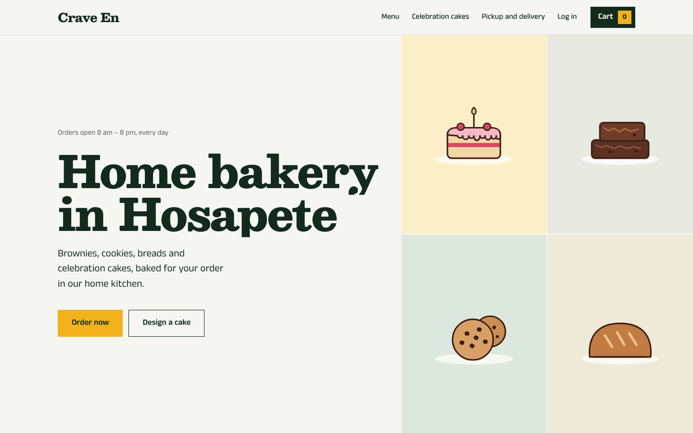
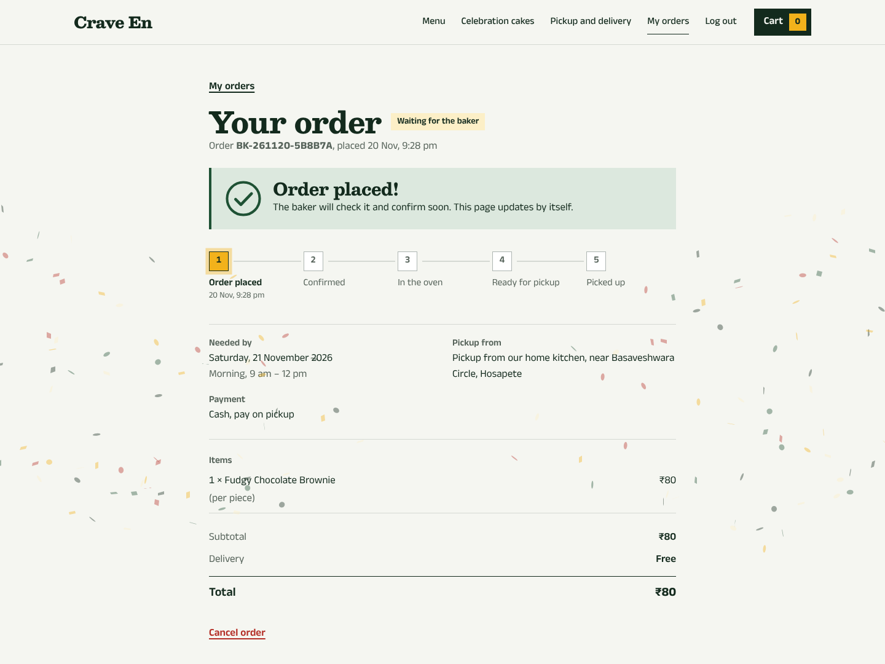
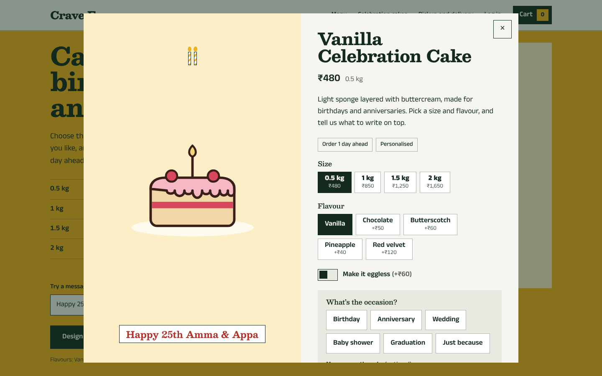
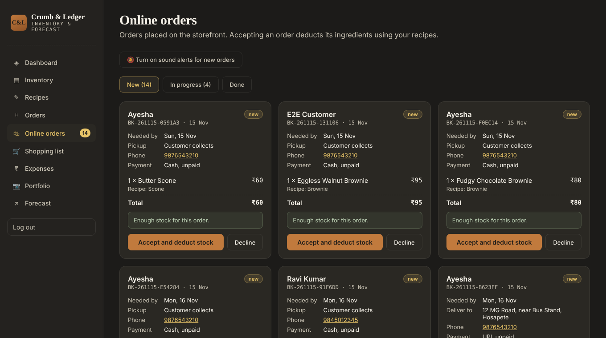
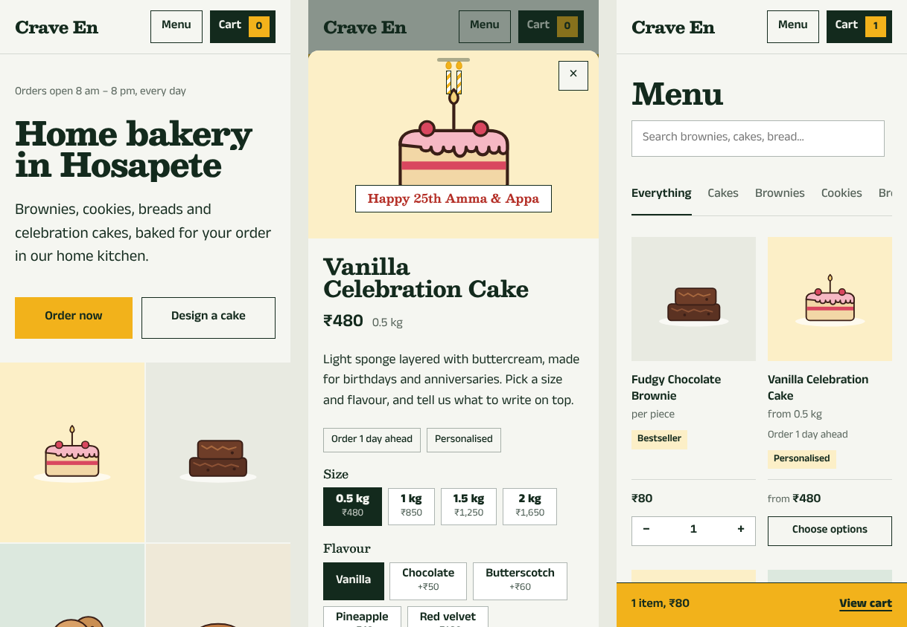
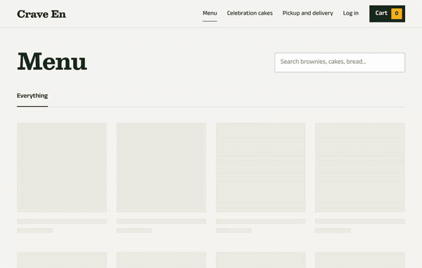

# Crave En

A MERN shop for a home bakery in Hosapete: the customer-facing side of the business. Customers browse the menu, design celebration cakes, order for a chosen date and time slot, and watch their order update live as it's confirmed and baked.

It works together with the [Smart Inventory System](https://github.com/haneef333/smart-inventory-system), the owner's app. A new order pings the owner instantly (sound + notification). When the owner **accepts** it, the ingredients are deducted automatically using each item's recipe, scaled by size: a 2 kg cake uses twice the 1 kg recipe. Every status change goes straight back to the customer's screen and inbox.

```
   Customer                                          Bakery owner
      │                                                    │
┌─────▼───────────┐  1. new order (REST)        ┌──────────▼─────────┐
│  Storefront     │ ──────────────────────────► │  Smart Inventory   │
│  React + Express│                             │  React + FastAPI   │
│  + MongoDB      │ ◄────────────────────────── │  + SQLite          │
└─────┬───────────┘  3. status updates (REST)   └──────────┬─────────┘
      │ Socket.IO: live status                    WebSocket: instant
      ▼ + email                                    new-order alert
   Customer's screen                              2. accept → recipe-based
                                                     stock deduction
```

## Screenshots

| Storefront | Order tracking |
|---|---|
|  |  |

| Designing a birthday cake | Owner: online orders |
|---|---|
|  |  |

| On a phone | Adding to the cart |
|---|---|
|  |  |

## Features

**Ordering**
- Menu with categories, search, quick-view sheets and star ratings
- **Celebration cakes:** sizes (0.5 / 1 / 1.5 / 2 kg), flavours, eggless, occasion (birthday, anniversary…), message on the cake with a live preview on the picture, candles, and a reference photo upload
- Cart that keeps each combination separate (a 1 kg chocolate and a 2 kg vanilla cake are two lines)
- Checkout with pickup or delivery, needed-by date (respects each item's notice period), **time slots** (slots closing within 2 hours can't be booked), notes, and cash or UPI on collection
- **Coupons** like `FIRST10` (first order only, percentage with a cap, minimum order, usage limits), all checked on the server
- **"Order again"** puts a past order back in the cart at today's prices

**After ordering**
- **Live order tracking with Socket.IO:** *Order placed → Confirmed → In the oven → Ready → Picked up / Delivered*, or *Declined* with the baker's reason
- **Emails** for order placed, confirmed, ready and declined (Nodemailer)
- Cancel until the baker accepts
- **Reviews:** rate items once you've received them; one review per item, editable

**Accounts**
- Email + password (bcrypt, JWT), **Continue with Google**, and **forgot password** by email (one-time, 30-minute link; only a hash of the token is stored)

**Look and feel** (reasons in [docs/DESIGN.md](docs/DESIGN.md))
- A visual identity based on Karnataka bakery signboards: Besley slab-serif headings, Anek Kannada text (it covers Kannada too), leaf-green ink, turmeric yellow and square corners
- Motion only where it helps (Framer Motion): a one-time hero reveal, a "how your order is made" story that changes as you scroll, a live message preview on the cake, the photo growing from the card into the quick view, the add-to-cart flight, the price counting as you choose options, and a live order tracker. Respects "reduce motion".
- Photo slots for the bakery's own photos (`client/src/photos.js`). Until a photo is added, a drawn bake fills its place.
- **Installable app (PWA):** add to home screen; loads instantly on repeat visits. Orders and stock always come fresh from the server.

**For the owner**
- Storefront: manage the menu (photo upload, sizes, flavours, eggless, celebration options) and coupons
- Inventory app: Online orders page with **instant alerts** (WebSocket + sound + browser notification), stock check, accept/decline, cake details and reference photos, and an **owner login**

## Tech stack

| Part | Tech |
|---|---|
| Frontend | React 19, Vite, React Router, Framer Motion (`motion`), Socket.IO client, Axios, vite-plugin-pwa |
| Backend | Node.js, Express 5, Mongoose 9, Socket.IO, JWT, bcrypt, Multer, Cloudinary, Nodemailer, google-auth-library |
| Database | MongoDB (local or Atlas) |
| Tests & CI | Vitest + Supertest (39 API tests), an end-to-end script across both apps, GitHub Actions |
| Integration | REST with a shared secret in both directions; WebSocket alerts in the FastAPI app |

## Run it locally

You need **Node 20+**, **MongoDB**, **Python 3.11+** and a copy of the [Smart Inventory System](https://github.com/haneef333/smart-inventory-system) next to this folder.

### 1. Inventory backend (FastAPI), terminal 1

```powershell
cd smart-inventory-system\fullstack\backend
pip install -r requirements.txt       # first time only
python -m uvicorn main:app --reload --port 8000
```

Optional, to try the owner login: `$env:OWNER_PASSWORD="pick-a-password"` (Mac/Linux: `export OWNER_PASSWORD=...`) before `uvicorn`.

### 2. Inventory website (owner app), terminal 2

```powershell
cd smart-inventory-system\fullstack\frontend
npm run dev                           # http://localhost:5173
```

`.env.development.local` points `npm run dev` at your local backend (port 8000). Your `.env.local` (the live Render URL) is still used for `npm run build`.

### 3. Storefront API, terminal 3

```powershell
cd server
copy .env.example .env                # first time only; set ADMIN_PASSWORD
npm install
npm run seed                          # owner account, menu with cake options, FIRST10 coupon
npm run dev                           # http://localhost:5000
```

Make sure `INVENTORY_API_URL` in `.env` uses the same port as uvicorn (8000).

### 4. Storefront website, terminal 4

```powershell
cd client
npm install
npm run dev                           # http://localhost:5174
```

### Try it

1. On **localhost:5173**, open **Online orders** and click **Turn on sound alerts**.
2. On **localhost:5174**, click **Design your cake**, pick 1 kg chocolate, type a message, add candles and place the order with code `FIRST10`. The owner tab dings straight away.
3. Accept it in the owner app. The customer page flips to **Confirmed** instantly, with confetti, and the cake's ingredients come out of stock.

## Tests

```powershell
cd server
npm test                              # 39 API tests; uses a separate bakery_test database
```

With all four servers running, `python scripts/e2e_flow.py` runs 60 end-to-end checks across both apps (add `OWNER_PASSWORD=...` if the inventory app has a login). It changes stock levels, so use local data only.

Every push to GitHub runs the API tests (against a real MongoDB) and a production build of the website (`.github/workflows/ci.yml`).

## Optional services

Each one switches itself on when its settings are in `server/.env` (details are in `.env.example`):

| Feature | Settings | Without them |
|---|---|---|
| Photo storage on Cloudinary | `CLOUDINARY_URL` | Photos are saved in `server/uploads` (fine locally, wiped on Render) |
| Continue with Google | `GOOGLE_CLIENT_ID` | The Google button is hidden |
| Real emails | `SMTP_HOST`, `SMTP_USER`, `SMTP_PASS` | Emails are printed in the server terminal |

## Deploy (free tiers)

Everything runs on free plans: **MongoDB Atlas** for the database and **Render** for the API and the website. `render.yaml` is a Render Blueprint that creates both services from this repo.

1. **Database (MongoDB Atlas):** create a free M0 cluster. Under *Database Access*, add a user; under *Network Access*, allow `0.0.0.0/0`. Copy the connection string and add the database name before the `?`, e.g. `...mongodb.net/crave_en?retryWrites=true&w=majority`.
2. **API and website (Render):** *New → Blueprint*, connect this repo, and fill in the values Render asks for:
   - `MONGO_URI`: the Atlas string from step 1
   - `CLIENT_URL`: `https://crave-en.onrender.com` (the website's address, no trailing slash)
   - `PUBLIC_URL`: `https://crave-en-api.onrender.com`
   - `VITE_API_URL`: `https://crave-en-api.onrender.com/api`
   - `INVENTORY_API_URL`: your inventory backend's Render address
   - `INTEGRATION_SECRET`: a long random string (the same one goes into the inventory backend)
   - `ADMIN_EMAIL` and `ADMIN_PASSWORD`: the owner's login for the shop
   - `CLOUDINARY_URL`: from a free Cloudinary account, so customers' reference photos survive restarts

   If Render gives a service a different address (it adds a suffix when a name is taken), update `CLIENT_URL`, `PUBLIC_URL` and `VITE_API_URL` to match and redeploy.
3. **Fill the menu:** from your own computer, run the seed once against Atlas:
   ```powershell
   cd server
   $env:MONGO_URI="<your Atlas string>"; $env:ADMIN_EMAIL="<same as on Render>"; $env:ADMIN_PASSWORD="<same as on Render>"
   npm run seed
   ```
4. **Inventory backend (already on Render):** in its *Environment*, add `INTEGRATION_SECRET` (same value as above), `STOREFRONT_API_URL=https://crave-en-api.onrender.com` and `OWNER_PASSWORD`, then redeploy. Point the owner website's `VITE_API_URL` at the inventory backend as before.

What to expect on free plans:
- The website is a static site, so it's always on. The free API **sleeps after 15 minutes without visitors** and takes about a minute to wake, so the first page load after a quiet spell is slow.
- Render's disk is wiped whenever a free service restarts. That's why photos go to Cloudinary. It also means the inventory app's SQLite database resets on restart, which is fine for a demo; moving it to Postgres is on the list below.
- The storefront keeps retrying an order until the inventory app wakes up, and the owner app reconnects its alert socket by itself.

Prefer Netlify for the website? `netlify.toml` is set up too: import the repo there and set `VITE_API_URL`.

## Project structure

```
server/
  src/
    app.js, index.js         Express app; HTTP server shared with Socket.IO
    models/                  User, Product (sizes, flavours, ratings), Order, Coupon, Review
    routes/                  auth, products, orders, coupons, reviews, uploads, integrations
    services/                inventoryClient (send + retry), realtime (Socket.IO), emails + mailer,
                             storage (Cloudinary or disk), coupons, google
    utils/                   pricing (options → price), slots, dates
  tests/                     Vitest + Supertest
client/
  src/
    pages/                   Home, Menu, ProductDetail, Cart, Checkout, Auth (login, register,
                             forgot, reset), Orders, OrderDetail, admin/ManageMenu, admin/ManageCoupons
    components/              ProductOptions, CakeMessage, ProductSheet, CartDrawer, RateOrder, Stars…
    context/                 Auth, Cart, Socket, FlyToCart, Toast
    pricing.js               live price preview (the server's numbers are what count)
    photos.js                the bakery's own photos for the home page
docs/DESIGN.md               why the shop looks and moves the way it does
scripts/e2e_flow.py          end-to-end check across both apps
render.yaml                  Render Blueprint (API + website)
```

## Design decisions worth knowing

- **Prices come from the database, not the browser.** The cart sends product IDs, quantities and chosen options; the server prices every option and re-checks the coupon.
- **Coupons count real orders.** Usage is counted from orders that weren't declined or cancelled, so a cancelled order gives the coupon back.
- **Recipe scaling travels with the order.** Each size has a recipe amount (0.5, 1, 2…), which the inventory app multiplies when deducting stock.
- **Uploads are checked by content.** The server reads the file's first bytes to confirm it's really a JPG, PNG or WebP, and only accepts photo links it created.
- **Live updates are private.** Each Socket.IO connection is checked with the login token and joins a room for that account only. A test confirms other customers never receive your updates.
- **Safe to retry everywhere.** Order delivery is idempotent (the order number is the key), accepting can't deduct stock twice, and status updates only move forward.

## Ideas for later

- Razorpay online payments
- TypeScript
- Move the inventory app from SQLite to Postgres so its data survives restarts on Render
- Delivery tracking on a map
